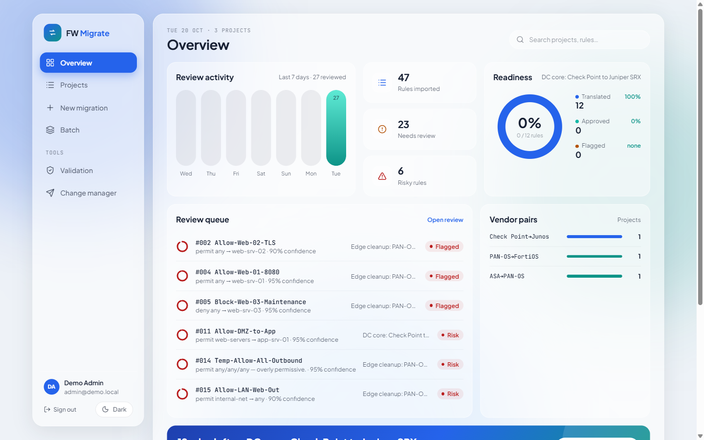
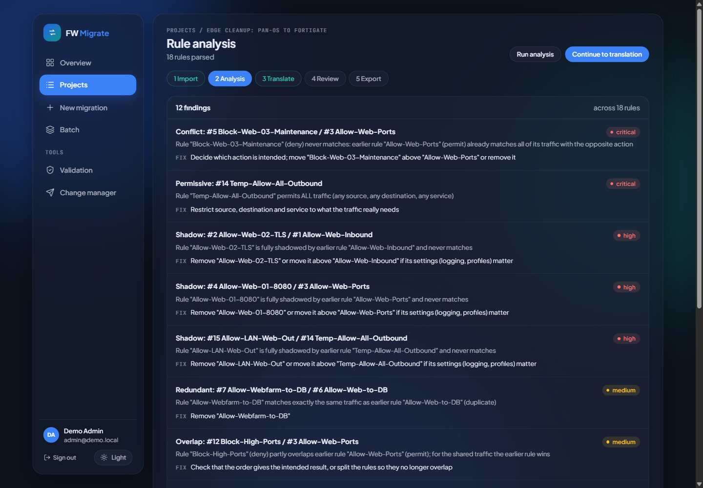
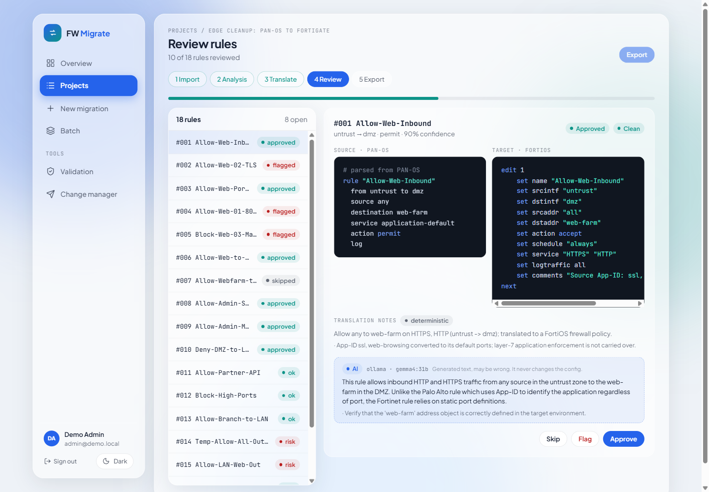
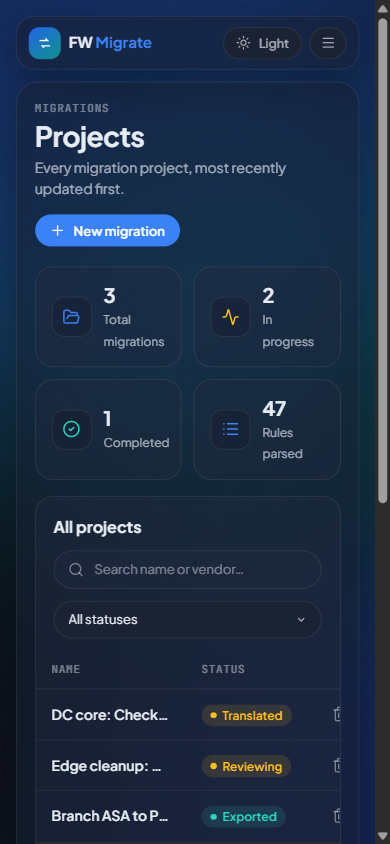

# FW Migrate

Firewall rule-base migration between vendors. Drop in or paste a source configuration; FW Migrate parses it into a vendor-neutral model, finds shadowed, duplicate, conflicting and over-permissive rules, translates every rule to the target vendor's syntax and lets an engineer approve each rule before exporting a complete target configuration.

Translation is deterministic: the same config always gives the same output. An LLM is optional. It only adds plain-language explanations, labelled as AI in the UI, and never writes or changes the generated config.



## Why

Firewall migrations are mostly careful bookkeeping: hundreds of rules, objects and services that have to be re-expressed in another vendor's syntax without changing what traffic is allowed. A migration is also the one chance to drop the rules nobody needs. FW Migrate does the mechanical translation, shows which rules never match or allow too much, flags anything it cannot translate exactly, and keeps a human approval step for every rule.

## Workflow

```
Import config -> Parse -> Analyse -> Translate -> Review -> Export
```

1. **Import** a configuration: drop or choose a file (the vendor is detected and checked against the project), or paste it. A config in which the project's parser finds no security rules (wrong vendor, empty export) is refused and nothing changes. Importing again replaces the config and discards the analysis, translation and review that came from it.
2. **Parse** it with the vendor's parser into rules, address/service objects and groups, and NAT rules.
3. **Analyse** the rule base (see [Rule analysis](#rule-analysis)).
4. **Translate** each rule with the target vendor's generator. Every rule gets a confidence score and review flags. On the same page, **zone mapping** sets the target interface or zone for every zone the rules use (default: the source name).
5. **Review** rule by rule: approve, skip, flag, or edit the generated config (saved as *modified* and exported instead). A reviewer note can go with any decision. The project moves to *Reviewing*, and to *Approved* once every rule has a decision.
6. **Export** the target configuration (objects + rules), a migration plan (checklists, per-rule rollback commands) or a summary report. Each lists the rules the review left out, with their status and note; the report's risk counts only the findings on exported rules.

Re-running a step never moves a project backwards unless something changed: a re-analysis keeps an *Exported* project *Exported*, and a re-translation keeps the review of every rule whose generated config is unchanged. Only rules whose output changed go back to pending.

## Supported vendors

Every vendor below has a parser, a generator and tests for both (`tests/parsers/`, `tests/generators/`). Any vendor can be the source or the target.

| Vendor | Source format (parser) | Target format (generator) |
|---|---|---|
| Palo Alto Networks (PAN-OS) | XML config export or `set` commands | `set` commands |
| Cisco ASA | `show running-config` | CLI: objects, extended ACLs, `access-group` |
| Check Point (R80+) | Management API JSON (`show access-rulebase` with objects dictionary) | `mgmt_cli` script |
| Fortinet FortiGate (FortiOS) | FortiOS CLI config | FortiOS CLI config |
| Juniper SRX (Junos) | `set` commands | `set` commands |

The list lives in one place, `src/lib/vendors.ts`; the API validators, the Prisma enum (checked by `tests/vendors.test.ts`), the parser/generator factories and the UI all derive from it.

## How translation works

Parsers keep each vendor's own tokens on the rule (`application-default`, `any`, `ALL`, `junos-https`, `tcp/443`, `tcp-8443`, ...). Generators never copy those tokens into another vendor's syntax:

- **Services** are first resolved to protocol/port specs (`src/lib/generators/services.ts`), then each target uses its own predefined service (FortiOS `HTTPS`/`DNS`/`PING`, Junos `junos-https`, Check Point `https`/`domain-udp`, PAN-OS `service-https`) or emits a custom service object.
- **PAN-OS App-ID with `application-default`** is resolved from the rule's applications to their standard ports: `ssl` -> 443, `web-browsing` -> 80, `dns` -> 53, `ssh`, `telnet`, `ftp`, `smtp`, `pop3`, `imap`, `ntp`, `snmp`, `syslog`, `ldap`, `ms-rdp`, `tftp`, `mssql-db`, `mysql`, `ms-ds-smb`, `kerberos`, `bgp`, `ping`, `icmp`. The App-IDs stay visible in the target rule's comment/description (and are kept as App-ID when the target is PAN-OS). Layer-7 enforcement is not carried over and the rule says so.
- **Anything that cannot be mapped** (an unknown App-ID, a service name not defined in the source) lowers the rule's confidence and adds a `REVIEW:` flag. A rule with no resolvable service is emitted **disabled**, never as a live rule with a guessed service.
- **Unapplied ASA access lists**: an ACL that no `access-group` binds filters no transit traffic on the ASA (it is unused, or matches traffic for VPN, NAT or QoS). Its rules are emitted **disabled** with a `REVIEW:` flag and confidence 30 %, an ASA target leaves the ACL unbound, and the analysis reports each rule. `access-group ... out interface` gives the ACL's egress zone.
- **Undefined addresses**: a name the source rule uses but the source config never defines gets a placeholder object (`255.255.255.255/32`, which matches no unicast traffic) so the target accepts the config, and the rule is emitted **disabled** with a `REVIEW:` note. Set the real address before enabling it.
- **Same-platform names**: Junos `junos-*` applications are predefined on the SRX, so an SRX -> SRX migration keeps them as they are; to any other target they are unresolved.
- **Objects**: every address, group and service a rule references is emitted before the rules, including objects created for literal IPs, ranges and FQDNs used directly in rules (SRX and FortiOS policies cannot reference literals).
- **FortiOS policy IDs**: policies are written as `edit 0`, so the FortiGate assigns the next free IDs and never overwrites an existing policy. The rollback commands look a policy up by its name.
- **Zones**: zone mappings from the project are applied. ASA rules go into `<nameif>_access_in` ACLs bound with `access-group` (source zone `any` -> global ACL, flagged); SRX rules with an `any` zone become global policies, and because Junos evaluates global policies after every zone policy, a global policy that sat above a zone-specific rule in the source is flagged with lower confidence; Check Point rules carry a flag that zones need security-zone objects.
- **Any vs all**: `any` becomes `all`/`ALL` on FortiOS, `Any` on Check Point, `ip` on ASA, `any` on PAN-OS and Junos.

`tests/generators/cross-vendor.test.ts` runs every source fixture through every generator and checks that each referenced object is defined or predefined and that no other vendor's keywords appear in the output.

## Rule analysis

Rules are compared by what they match, not by their names. Before any check runs, every rule is resolved (`src/lib/analysis/ObjectResolver.ts`):

- address objects, ranges, `address mask` notation and FQDN objects;
- address groups, including nested groups (with loop protection);
- service objects and service groups, vendor-predefined services (`HTTPS`, `junos-https`, `domain`, ...);
- PAN-OS App-IDs with `application-default`, which narrow a rule to those applications on their standard ports.

The resolved rules are compared as IPv4 and port sets, per zone pair, and for Cisco ASA only inside the same access list. Findings:

| Finding | Severity | Meaning |
|---|---|---|
| Conflict | critical | An earlier rule with the opposite action already matches all of this rule's traffic; this rule never matches |
| Permissive | critical to low | any/any/any (critical), every service from any source or to any destination (high), any to any on specific services (medium), every service between specific networks (low) |
| Shadow | high | An earlier rule with the same action matches all of this rule's traffic |
| Redundant (duplicate) | medium | Same traffic as an earlier rule (often the same objects under two group names) |
| Overlap | medium | Partly shared traffic with the opposite action, so rule order decides |
| Redundant | low | A later rule with the same action already covers this one, and nothing in between treats that traffic differently |
| Disabled | info | Disabled rule, a candidate to leave out of the migration |
| Unresolved | info | The rule references names that are not defined in the config; those are treated as unknown, never as a match |

An explicit deny above the final deny-all is not reported as redundant, since it is normally there on purpose (logging, documentation).

`tests/fixtures/paloalto-legacy-ruleset.xml` is a grown edge rule base in which every finding above only shows up through object resolution; `tests/analysis/object-resolution.test.ts` checks each one, and that none of the group-based findings appear without resolution.



## Quick start

Works the same on Windows (PowerShell or Git Bash), Linux and macOS.

Requirements: Git, Node.js 22 or newer, Docker with Compose. An LLM is not required.

```bash
git clone https://github.com/falshaw/fwmigrate.git
cd fwmigrate
cp .env.example .env
```

Open `.env` and fill in the four empty secrets (`POSTGRES_PASSWORD`, `FWMIGRATE_DB_PASSWORD`, `REDIS_PASSWORD`, `AUTH_SECRET`). Generate each one with either command, which gives a 64-character hex string:

```bash
openssl rand -hex 32
node -e "console.log(require('crypto').randomBytes(32).toString('hex'))"
```

If port 3004, 5436 or 6383 is already taken on your machine, change `APP_PORT`, `POSTGRES_PORT` or `REDIS_HOST_PORT` in `.env` (and the port in `NEXTAUTH_URL`).

Start the stack, then create the schema and the admin user from the host (the Prisma CLI and the seed connect to the Postgres container with `POSTGRES_PASSWORD` and `POSTGRES_PORT`):

```bash
docker compose up -d --build
npm install --include=dev
npx prisma generate
npx prisma db push
npx prisma db seed
```

The seed prints the login: `admin@demo.local` and a random password (or `SEED_ADMIN_PASSWORD` if set). Open http://localhost:3004 (or your `APP_PORT`). There is no self-registration; an admin adds users under **Users**.

To try it: **New migration** (for example Palo Alto -> Fortinet), drop `tests/fixtures/paloalto-legacy-ruleset.xml` on the import page, then run analysis, translate and review. The other fixtures in `tests/fixtures/` cover every source vendor.

`npm install --include=dev` matters: the Prisma CLI and `tsx` (used by the seed) are dev dependencies, and npm skips them when `NODE_ENV=production` or `omit=dev` is set in your npm config.

Stop the stack with `docker compose down` (add `-v` to delete the database volume).

## Optional LLM

Set `LLM_PROVIDER` in `.env` and recreate the app container (`docker compose up -d fwmigrate-app`):

| `LLM_PROVIDER` | What it does |
|---|---|
| `none` (default) | No LLM. Import, analysis, translation, review and export all work. |
| `ollama` | Calls Ollama's API at `OLLAMA_HOST` (default `http://host.docker.internal:11434`) with `OLLAMA_MODEL`. |
| `claude` | Sends `POST {CLAUDE_BRIDGE_URL}/generate` with an `X-Bridge-Token` header to a host-side gateway, so the container never holds a model API key. A compatible gateway is in the companion repo [secure-private-ai](https://github.com/falshaw/secure-private-ai). |

Translation returns immediately either way. With an LLM configured, per-rule explanations run afterwards as a background job, bounded by `LLM_TIMEOUT_MS` per call, `LLM_CONCURRENCY` parallel calls and `LLM_EXPLAIN_MAX_RULES` rules per run; the translate page shows progress. LLM calls sit behind a circuit breaker.

AI text is stored apart from the generator's deterministic notes. On the review page it sits in its own panel with an **AI** badge and the provider and model name (for example `ollama · gemma4:31b`); the deterministic notes are tagged *deterministic*. A rule keeps its AI explanation when a re-translation leaves its config unchanged. **Explain with AI** on the review page asks for one rule's explanation on demand.



## Features

- Five vendors, each as source and target (table above)
- Import by file (drag and drop or file picker, vendor detection, 20 MB limit) or paste
- Rule analysis on resolved objects and groups: conflicts, shadows, duplicates, redundant rules, risky overlaps, permissive rules, disabled rules, undefined objects
- Validation of raw configs or of the config a project would export (`src/lib/validation/ConfigValidator.ts`): vendor syntax, plus every address, group and service a rule references must be defined or predefined (`src/lib/validation/references.ts`; a device rejects a rule with an unknown name, even a disabled one). Rule order is judged by the analysis step, not here.
- Deterministic translation with per-rule confidence and review flags
- Per-rule review; fast reviewing is limited per user (600 decisions a minute), not per browser
- Project history: every step (parsed, analysed, translated, reviewed, exported, config replaced) with who did it and the counts at the time
- Batch migrations (up to 50 configs per batch, vendor detected per file); the batch export is one complete config per file (objects, then rules), marked as not reviewed
- Exports: complete target config, migration plan with rollback commands, report
- Delete a project (admins) with everything that belongs to it
- Optional push of approved rules to an external change-management system over HTTP; the push button stays disabled, with the reason, while that system is not configured or not reachable
- Multi-tenant: users belong to an organisation; all data is organisation-scoped
- Roles, enforced in the API and reflected in the UI: `VIEWER` reads, validates and downloads exports; `CONSULTANT` also imports, analyses, translates, reviews, exports and pushes; `ADMIN` also deletes projects and manages users (create, role, deactivate, new password, unlock a locked account). Role changes apply on the next request.
- Light and dark theme, usable from 390 px wide



## Architecture

```
Browser ──> Next.js app (UI + /api routes, NextAuth sessions)
              ├── PostgreSQL 16 (Prisma 7 + @prisma/adapter-pg)
              ├── Redis (sign-in lockout, caching)
              ├── optional LLM: Ollama or an authenticated HTTP LLM gateway
              └── optional external change-management API
```

- **Auth**: NextAuth v5 credentials provider, bcrypt password hashes, role-based access. Five failed sign-ins lock the address for 15 minutes (kept in Redis); the login page says so, and failures count for unknown addresses too, so the message reveals no accounts. Unauthenticated API calls get `401` JSON.
- **API**: REST under `/api/v1/*`. Every route goes through `apiHandler` (session check, Zod validation, rate limit, correlation ID, structured logging). Rate limits are in memory, per client address (100 requests a minute by default, lower on expensive routes); review decisions are counted per signed-in user instead.
- **Change-management push**: `POST /api/v1/integrate/change-manager` sends approved/modified rules as JSON to `{CHANGE_MANAGER_API_URL}/api/rules/import`; `GET /api/v1/integrate/status` probes `{CHANGE_MANAGER_API_URL}/api/health`. Any system exposing those two endpoints works. With `CHANGE_MANAGER_API_URL` unset the integration is off.
- **Container hardening**: all services drop all capabilities and set `no-new-privileges`; the app runs read-only as a non-root user with tmpfs for `/tmp` and `.next/cache`; Postgres creates a separate least-privilege `fwmigrate` role (`postgres/init-user.sh`) that the app uses. Host ports bind to `127.0.0.1` only.

## Stack

Next.js 16, React 19, TypeScript, Tailwind CSS 4, Prisma 7, PostgreSQL 16, Redis, NextAuth v5, Zod, fast-xml-parser, Vitest.

## Local development

With Postgres and Redis from Compose (`docker compose up -d fwmigrate-postgres fwmigrate-redis`) and the schema pushed:

```bash
npm install --include=dev
npx prisma generate
npm run dev               # http://localhost:3004
```

`npm run dev` connects as the Postgres superuser built from `POSTGRES_PASSWORD`; set `DATABASE_URL` to use another database.

## Configuration

| Variable | Required | Purpose |
|---|---|---|
| `POSTGRES_PASSWORD` | yes | Postgres superuser password (schema push, seed, local dev) |
| `FWMIGRATE_DB_PASSWORD` | yes | Password of the app's least-privilege DB role |
| `REDIS_PASSWORD` | yes | Redis auth |
| `AUTH_SECRET` | yes | NextAuth secret, at least 32 characters (`openssl rand -hex 32`) |
| `APP_PORT` / `POSTGRES_PORT` / `REDIS_HOST_PORT` | no | Host ports, default `3004` / `5436` / `6383` (bound to 127.0.0.1) |
| `NEXTAUTH_URL` | no | Public URL, default `http://localhost:3004` |
| `DATABASE_URL` | no | Only to override the connection string built from `POSTGRES_PASSWORD` (Compose sets the container's own) |
| `SEED_ADMIN_PASSWORD` | no | Seed admin password (random if unset) |
| `LLM_PROVIDER` | no | `none` (default), `ollama` or `claude` |
| `OLLAMA_HOST` / `OLLAMA_MODEL` | no | Default `http://host.docker.internal:11434` / `qwen2.5:14b` |
| `LLM_TIMEOUT_MS` / `LLM_CONCURRENCY` / `LLM_EXPLAIN_MAX_RULES` | no | Per-call timeout (90000), parallel calls (1; a local Ollama usually serves one request at a time, extra calls only queue and time out), rules explained per run (50) |
| `OLLAMA_RELEASE_AFTER_BATCH` | no | Default `true`: unload the model when the explain job finishes, so a large local model frees its RAM at once; a single "Explain with AI" on the review page keeps Ollama's 5-minute keep-alive. `false` = keep it loaded |
| `CLAUDE_BRIDGE_URL` / `CLAUDE_BRIDGE_TOKEN` / `CLAUDE_MODEL` | no | LLM gateway URL, shared token, model alias |
| `CHANGE_MANAGER_API_URL` / `CHANGE_MANAGER_API_KEY` | no | External change-management system and its bearer token (unset = integration off) |
| `ENCRYPTION_KEY` | no | 64 hex chars, used by `src/lib/crypto.ts` |

## Tests

```bash
npm test                  # Vitest
npm run test:coverage
npm run typecheck
npm run lint
```

- `tests/parsers/`: each parser against a synthetic config in `tests/fixtures/`.
- `tests/generators/`: PAN-OS fixture -> FortiOS in detail, every source/target pair for valid references and leaked keywords, and output a device loads (placeholders for undefined names, FortiOS `edit 0`, same-platform service names).
- `tests/validation/`: every generated config validates without errors; undefined references are errors, normal block syntax raises no warnings.
- `tests/analysis/`: the analysis engine, object and group resolution, and the findings on every fixture.
- `tests/lib/`: project status rules (re-runs never move a project back), rate limits, role enforcement, and the enabled state pushed to Change Manager.
- `tests/ui/`: vendor detection, file upload checks, the delete dialog and that every project table cascades on delete, Change Manager push gating, safe sign-in redirects.
- `__tests__/`: network utilities, crypto.
- `tests/vendors.test.ts`: the vendor list, Prisma enum, API validation and this README agree.

The fixtures use only RFC 5737 documentation addresses, RFC 1918 ranges and `example.com` names.

## Limits

Be aware of what it does not do:

- **IPv4 only.** The analysis compares IPv4 only; IPv6 addresses show up as *unresolved*, and the fixtures and tests cover IPv4 only.
- **Pairwise analysis.** A rule hidden only by the combination of several earlier rules is not reported as shadowed. Dynamic address groups, user/group matching, schedules and security profiles are not part of the comparison.
- **Layer 7 is not translated.** PAN-OS App-IDs become their standard ports on other vendors; App-ID enforcement is lost and the rule says so. App-IDs outside the built-in list are flagged for review, not guessed.
- **Security policy only.** NAT rules are parsed and counted but not translated; routes, interfaces, VPNs and device settings are out of scope.
- **Syntax validation is static.** It checks the generated config's structure and references, not whether a real device accepts it. Test on a lab device before production.
- **Single instance.** Rate limits and the AI explanation queue are kept in memory, which suits the one-container deployment in `docker-compose.yml`, not a cluster.
- **No self-registration or password reset by e-mail.** An admin creates users and sets passwords; the seed creates the first admin.
- **Batches cannot be deleted from the UI** yet; deleting a project does not change the batch that created it.
- AI explanations are generated text and can be wrong. They never change a config, and they are always labelled.

## License

MIT, see [LICENSE](LICENSE).
